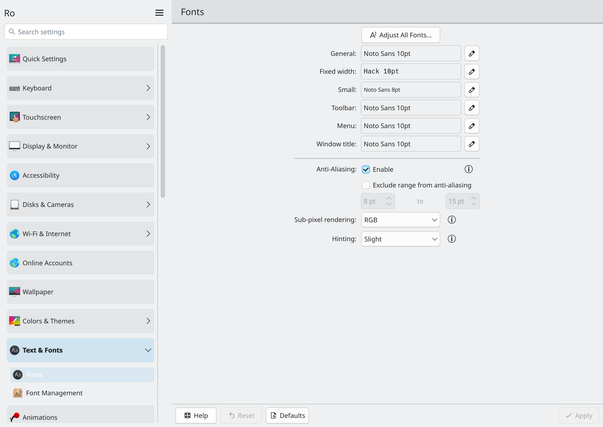

# KDE-native Ro skin — izole prototip teslimi

Tarih: 2026-10-23. Repo: Project-Ro-ASD/Ro-KDE-SystemSettings.
[Draft PR #8](https://github.com/Project-Ro-ASD/Ro-KDE-SystemSettings/pull/8).
Yetki kapsamı yalnız izole geliştirme/doğrulama; production değişimi/yayını yok.
PR #7 değiştirilmedi. Bağımsız ELF/KCM host kodu bu çalışmaya taşınmadı.

## Beş soruya doğrudan yanıt

1. **Ro arayüzü KDE'nin kendi uygulamasında çalışıyor mu? Evet, prototip kapsamıyla.**
   Orijinal `systemsettings` hedefi ve `SettingsBase` penceresinde, aynı
   `SidebarMode` context'i/engine'i ve gerçek MenuModel/proxy modelleriyle
   Ro sidebar/kategori kartları/akordeon/arama çalıştı. Gerçek Fonts KCM'i
   açıldı; KDE'nin kendi Apply/Reset/Defaults düğmeleriyle geçici kullanıcı
   ayarı diske yazıldı ve yeniden okundu. Offscreen testlere ek olarak hostun
   gerçek Wayland/Plasma ekranına bağlanan izole konteyner penceresinde de
   seçili etkileşimler doğrulandı. Bu, tüm KCM/donanım/Polkit kabulü değildir.
2. **Yama boyutu:** tek upstream dosya, `app/SidebarMode.cpp`, **29 ekleme / 8 silme**.
   Ayrı yeni görsel dosya `Main.qml` 203 satırdır. Test sürücüsü ve test CMake
   eklemesi bu sayıya dahil değildir; bunlar native RPM'e veya kaynak yamasına
   girmez. Yeni bir settings executable hedefi veya KCM host yazılmadı.
3. **Minor bakım yükü:** altı gerçek KDE etiketinde aynı yama elle kod değişmeden,
   sıfır fuzz ile uygulanabildi. 6.6.5 ve 6.7.5 uygulama kaynakları aynı skin ile
   derlenip çalıştırıldı. Bununla birlikte KDE'nin QML context/model arayüzü
   kararlı public skin ABI'si değildir. Her Fedora güncellemesinde source/rebuild
   ve runtime kapısı gerekir; bütün gelecek minor sürümlere garanti verilemez.
4. **Fedora güncellemesi görünümü koruyor mu? Kesintisiz korumuyor.** Gerçek DNF
   işlemiyle stock Fedora 6.7.5, yamalı 6.6.4'ü yükseltti; skin dosyaları kaldı,
   fakat Ro görünümü kayboldu. Eşleşen yamalı 6.7.5 kurulunca değişmeyen skin ile
   geri geldi. Bu, güvenlik güncellemesini kilitlemeden çalışır.
5. **Küçük ekip için sürdürülebilir mi? Dar prototip koşullu olarak makul.**
   Tek dosyalık yama ve 203 satırlık görünüm küçük kalıyor; yeni backend/servis yok.
   Asıl sürekli maliyet Fedora SRPM rebuild'i ve gerçek oturum QA'sıdır.
   Public upstream seçim sözleşmesi olmadan sıfır bakım vaadi verilemez.
   QML context uyarlaması düzenli ve geniş kapsamlı hale gelirse bu yaklaşım
   büyütülmemeli. Mevcut kanıtlar büyük fork gerektirdiğini göstermiyor.

## Mimari ve kaynak sahipliği

KDE `plasma/systemsettings` shell/navigation sahibidir. Birincil taban
`v6.7.5` / `d126c08d14a2a0f44a1758fd25e945ae099e34bb`.
İncelenen gerçek Fedora SRPM'leri `6.6.4-1.fc44` ve `6.7.5-1.fc44`;
iki spec'te de ilave Fedora source patch'i yok. 6.7.5 SRPM'indeki
`SidebarMode.cpp`, KDE etiketindeki dosyayla birebir karşılaştırıldı.
Resmi Koji URL'leri, upstream commit'leri ve SRPM/source tar SHA256 değerleri
`.roasd/native-prototype-bases.json` içindedir.

Seçilen çözüm **dar native source patch + ayrı görsel kaynak paketi**dir.
KDE kaynak ağacı vendörlenmedi; checkout `.work/upstream/systemsettings` altındadır.
Generic Breeze/Kirigami tema değişimi yapılmadı; o sorumluluk Ro-Theme'de kalır.
KCM sağlayıcılarına source patch uygulanmadı. Fonts KCM'i KDE plasma-workspace
6.7.5'ten, test edilen Fedora `plasma-workspace-libs` paketinden gelir.

`RO_SYSTEMSETTINGS_SKIN=1` yalnız System Settings modunda sabit, paket yöneticisine
ait `/usr/share/ro-kde-systemsettings/native/Main.qml` dosyasını seçer.
URL/path enjeksiyonu, LD_PRELOAD, sembol interposition veya yeni private C++ ABI
hook'u yok. InfoCenter seçim dışında kalır. Varsayılan davranış stock'tur.
Eksik/bozuk kaynak ya da yanlış kök sözleşmesinde orijinal gömülü QML kullanılır.
Her denemede ayrı QQmlComponent gerekir; ilk deneyde component hata durumunun
yeniden kullanımda kaldığı yakalandı, düzeltildi ve negatif testlerle doğrulandı.

Kök doğrulaması QQuickItem, sonlu pozitif genişlik ve sonlu/negatif olmayan
headerHeight kontrolüdür. Başarıyla yaratıldıktan sonraki her JavaScript binding
hatasını veya anlamsal model değişimini otomatik kurtaramaz. Uyumluluk kapısı
bu nedenle gereklidir. Orijinal SettingsBase, ModuleView, MenuModel ve
MenuProxyModel dosyalarının test edilen SHA256'ları upstream ile aynı kaydedildi.
KCM keşfi, unsaved-change çözümü, save/load/defaults ve KAuth/KAuthorized
uygulaması değiştirilmedi; bu kaynak eşitliği gerçek Polkit testinin yerine geçmez.

## Çalışan görsel bileşenler ve sınırlar

- Ro başlığı, uygulama kapsamındaki yüzeyler ve yuvarlatılmış kategori kartları.
- Tek kategorinin native alt modelini açıp kapatan akordeon görünümü.
- Orijinal KDE arama filtresini kullanan arama alanı ve gerçek KCM sonucu tıklama.
- Orijinal KDE QAction nesnelerine bağlanan menü; yeni ayar menüsü backend'i yok.
- KDE tema/palet ve ikon sistemini kullanan native KDE/Wayland görünümü.
- KDE yerelleştirme context'iyle EN/TR Ro metinleri; Türkçe placeholder görüntülendi.

Native KCM sayfaları Ro tarafından yeniden yazılmadı. Fonts ayarı testte KCM'in
kendi QObject ayar özelliğinden değiştirildi; orijinal QWidget Apply/Reset/Defaults
düğmeleri tıklandı. Font seçici diyaloğunun uçtan uca fiziksel kullanıcı testi
yapılmadı. Alt kategori yardımcı eylemleri/default göstergeleri ve tüm klavye,
ekran okuyucu, RTL/dark-mode ayrıntılarında stock parity kabulü tamamlanmadı.
Bu nedenle görünüm prototipi tam ürün olarak sunulmuyor.

[Türkçe Wayland görünümü](evidence/native-prototype/wayland-tr.png).
Görüntüler test sırasında gerçek compositor'a bağlı native uygulama client
penceresinden alınmıştır; masaüstü oturumunun tamamını doğrulamaz.

## Gerçek RPM işlemleri

Native executable sahibi bütün aşamalarda `plasma-systemsettings` kaldı.
Ayrı `ro-systemsettings-native-skin-prototype` noarch RPM'i yalnız Main.qml,
Türkçe MO ve lisans metnini taşır; executable, servis, global environment,
KCM veya paylaşımlı kitaplık içermez. Native RPM QtTest sürücüsüne bağımlı değildir.
Production CMake/spec/launcher veya release workflow değiştirilmedi.

İzole DNF testi 32 başarılı komutla şu sırayı doğruladı:

| İşlem | Sonuç |
| --- | --- |
| Gerçek Fedora SRPM'inden yamalı 6.6.4 + ayrı skin | Native RPM çalışırken harici Ro kökü yüklendi. |
| Gerçek stock Fedora 6.7.5'e normal upgrade | Yeni Fedora paketi kazandı; aynı skin dosyası kaldı, Ro kökü kullanılmadı. |
| Eşleşen yamalı 6.7.5'e upgrade | Aynı skin hash'iyle Ro görünümü geri geldi. |
| Skin RPM'ini kaldırma | QML/MO kalktı; yamalı native executable gömülü stock köke döndü. |
| Fedora RPM'ine ayrıca downgrade | Binary hash'i stock durumuyla eşleşti; rpm doğrulaması temizdi. |

Her aşamada RPM doğrulaması ve tekil dosya sahipliği kontrol edildi. Skin kaldırma
binary paketini kendiliğinden Fedora sürümüne döndürmez; iki işlem açıkça ayrıldı.
İlk dil-sahipliği denemesi, imajın `%_install_langs en_US` filtresi TR dosyasını
kurmadığı için başarısızdı. Yalnız geçici konteynerde dil filtresi `all` yapıldı;
son transaction testi Türkçe dosyanın varlığı/sahipliğini de kontrol ederek geçti.
Eski Ro 0.1.0 paketinden yeni ürün migrasyonu bu prototipte uygulanmadı.

Versionlock, Epoch artırımı, Fedora security güncellemesini engelleyen conflict
veya kesin sürüm sabitlemesi eklenmedi. Aynı upstream sürümün daha yüksek Fedora
Release'i için yalnız RPM sıralama hesabı incelendi; bulunmayan security RPM'i
uydurulup gerçek güncelleme testi gibi gösterilmedi. Yapılan gerçek minor geçiş
6.6.4 → 6.7.5'tir.

## Güncelleme ve otomasyon önerisi

Fedora update akışı açık kalmalı. Yeni SRPM geldiğinde resmi kaynak kimliğini
ve Fedora patch serisini doğrulayan izole job, değişmemiş yamayı sıfır fuzz ile
uygulayıp SRPM/RPM derlemeli. Model/QML kaynak değişiklikleri, iki son desteklenen
minor, opt-out/negatif fallback, gerçek KCM round-trip, RPM update/remove ve
performans örnekleri birlikte kapı olmalı. Desteklenen her major için yeni kabul
çalışması gerekir. Başarısızlık halinde stock Fedora güncellemesi akmaya devam
eder; Ro görünümü geçici kaybolur. Onaylanmamış build otomatik yayımlanmaz.

Prototype hazırlayıcı bilinmeyen/tahrif edilmiş SRPM'i çıktı oluşturmadan reddeder.
Yeni onaylı kaynak kimliği metadata'ya eklenir; olağan durumda KDE source kodunu
elle düzenlemek gerekmez. Fedora yeni yama serisi eklerse otomatik varsayım yerine
inceleme istenir. Bu strateji önerisidir; production scheduler/signing/release
çalıştırılmadı. Mevcut normal branch CI, native prototipin manuel testleriyle aynı
şey değildir ve onun yerine sunulmaz.

Upstream'e genel amaçlı paket kontrollü QML shell seçimi/fallback önerilebilir.
Ro'ya özel adların genelleştirilmesi ve KDE'nin hangi root/context özelliklerine
uyumluluk sözü vereceğinin belirlenmesi gerekir. Tek yükleyici yaması public skin
API'si yaratmaz. Bu görevde upstream'e issue/PR/mesaj gönderilmedi.

## Performans: ölçülen değerler

Üçer deneme, 5. saniye, Fedora 44, Qt 6.11.2/KF6 6.31, offscreen/software,
aynı sağlayıcı kümesi, touchpad hariç. Test sürücüsüz gerçek Fedora/native RPM
executable'ları kullanıldı. Yalnız uygulama PID'i ölçüldü; KDE'nin standart
ActivityManager gibi paylaşılan servisleri ve tüm oturum maliyeti dahil değil.

| Mod | RSS medyanı (KiB) | PSS medyanı (KiB) | 5. saniyeye kadar CPU (s) | Son 1 s CPU (s) |
| --- | ---: | ---: | ---: | ---: |
| Orijinal Fedora 6.7.5 | 127728 | 106425 | 0.58 | 0.00 |
| Yamalı 6.7.5, stock görünüm | 127544 | 106140 | 1.39 | 0.01 |
| Yamalı 6.7.5, Ro görünüm | 126028 | 104592 | 0.52 | 0.00 |

Bu dar örnekte Ro için ek resident bellek gözlenmedi. Başlangıç CPU farklarını
nedensel hızlanma veya bütün oturumda regresyon yokluğu olarak yorumlamıyoruz;
çalışma sırası/cache/arka plan etkileri kontrollü bir benchmark düzeyinde ayrılmadı.
İlk frame gecikmesi, GPU render maliyeti ve gerçek oturum idle testi ölçülmedi.
Önceki bağımsız uygulamanın ölçümleri buraya aktarılmadı.

## Test matrisi ve açık engeller

| Kontrol | Kanıt / karar |
| --- | --- |
| Fedora SRPM inceleme + gerçek 6.6.4/6.7.5 RPM/SRPM rebuild | PASS; hash'ler ve spec bilgileri kaydedildi. |
| Yama uygulanabilirliği: 6.6.4, 6.6.5, 6.7.0, 6.7.4, 6.7.5, 6.8.1 | PASS; sıfır fuzz, bazı sürümlerde bir satır offset. |
| Native UI + Fonts save/reset/default/reload: 6.6.5 ve 6.7.5 | PASS; aynı Fedora 44 SDK/runtime, touchpad hariç. |
| Dokuz seçim/fallback durumu × iki gerçek KDE kaynak sürümü | PASS; eksik dosya/import, syntax, yanlış root, eksik/NaN header ve sıfır genişlik dahil. |
| Gerçek Wayland/Plasma, KDE tema, EN UI + Fonts round-trip | PASS; izole D-Bus/HOME ve sınırlı sağlayıcı kümesi. |
| Gerçek Wayland Türkçe Ro metni | PASS; C-only locale imajı gerçek locale paketleriyle tamamlandı. |
| Fiziksel input/popup ve tüm klavye/erişilebilirlik | NOT VERIFIED; sentetik Wayland girdisinde bir popup-grab denemesi de başarısızdı. |
| Polkit prompt/authorize/deny ve privileged KCM | NOT VERIFIED; host system/KWin D-Bus ve auth agent paylaşılmadı. |
| Tam donanım KCM kümesi | BLOCKED; aşağıdaki bağımsız stock çöküşü. |
| 6.8.1 runtime, özgün tarihsel 6.6 dependency stack'i | NOT VERIFIED; kaynak uygulama testiyle karıştırılmadı. |
| Temiz install/update/remove/stock restore ve sahiplik | PASS; gerçek konteyner DNF/RPM işlemleri. |
| validate.py, test-contract.py, Python/shell sözdizimi, source hash reddi | PASS. |
| Yeni release attestation | BLOCKED / NOT VERIFIED. |

**Stock touchpad sorunu:** güncel yeni GDB kaydı, Ro kaynakları kaldırılıp
orijinal Fedora binary'si geri yüklendikten sonra yine SIGSEGV yakaladı:
`TouchpadModuleData::TouchpadModuleData` → `kcm_touchpad.so` →
`MenuItem::setMetaData` → `SettingsBase::initMenuList/initApplication`.
Bu Ro hatası değildir. Sınırlı testlerde dosya yalnız konteynerde keşif dışına
alındı; shipping paketten çıkarılmadı, sonra geri konuldu. Mouse/landingpage gibi
KCM'lerde eksik KWin/input backend kaynaklı uyarılar da vardı. Bunlara tüm KCM
PASS verilmedi. Hosttaki önceki `rpm -V` kullanıcı/grup farkı da düzeltilmedi
ve temiz bütünlük iddiasına dönüştürülmedi; hosta transaction uygulanmadı.

## Lisans, kanıtlar ve teslim kararı

Eski main envanteri **107 dosya / 49 SPDX-köken engeli** olarak açık kalır.
Bu belirsiz dosyalar yeni skin RPM'inin allowlist'ine alınmadı. Yeni QML/TR
kaynakları özgün ve GPL-3.0-only başlıklıdır; yama hedefin GPL-2.0-or-later
bildirimlerini korur. Fedora native SRPM'inin lisans/notice seti korunur.
Bu, legacy production paketinin lisans engellerini kapatmaz.

Makinece okunabilir [kanıt paketi](evidence/native-prototype/results-2026-10-23.json)
test assertion'larını, 32 RPM komutunun çıktısını, gerçek root marker'larını,
performans ham sonuçlarını, kaynak/çıktı hash'lerini ve stock GDB kesitini içerir.
Tam loglar/RPM/SRPM yalnız yerelde `.work/native-prototype/` altındadır.
[Tekrarlama prosedürü](../prototypes/native-skin/README.md) test instrumentasyonunu
ve bütün ortam sınırlamalarını açıklar.

Önceki başarılı CI/RPM kanıtları korundu; yeni native kabulü yerine geçirilmedi.
Otomatik onay denetiminin önceden reddettiği `release.yml` dispatch kullanıcının
talimatıyla tekrar denenmedi veya dolaylı tetiklenmedi. Mevcut attestation/manifest
kontrolleri yeni release attestation yerine sayılmadı. Tag/release, merge,
production signing, Beta/Stable veya Ro-Repo kabulü yapılmadı.

**İzole prototip: incelemeye hazır. SOURCE READY (tam ürün/production): HAYIR.**
**RO-REPO ADMISSION READY: HAYIR. FULL UI PASS: VERİLMEDİ.**
Kalan iş: gerçek oturumda Polkit/privileged KCM, tüm sağlayıcı/donanım ve UI parity
kabulü; legacy lisans/payload temizliği; sürdürülebilir upstream sözleşmesi ve
production paketleme kararı. Bu teslim production yetkisini genişletmez.

Değişen repo alanları: tek upstream patch ve notları; yeni `prototypes/native-skin/`
kaynakları/spec'i; kaynak kimliği metadata'sı/hazırlayıcı; native build/UI/fallback/
RPM/performance testleri; README/test dokümantasyonu ve bu rapor/kanıtlar.
